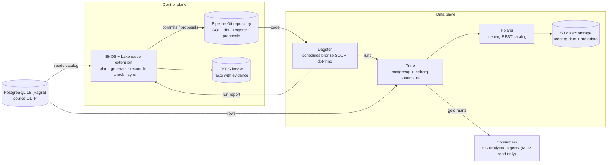
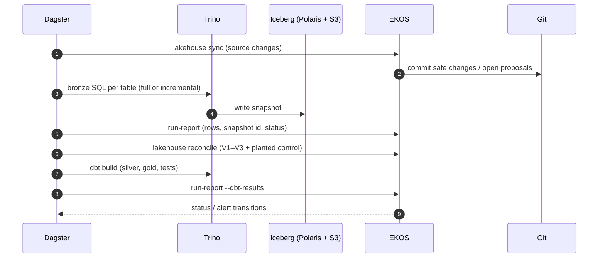

# Architecture description

## Context

EKOS is in the control plane only: it reads the source catalog, generates pipeline code into Git and records every run and check as facts. Trino moves the rows, Dagster schedules runs, and people approve what is lossy, breaking or business-facing (merge = approval).

## Components

| Component | Role | Endpoint / setting |
|---|---|---|
| Source | PostgreSQL 18 (Pagila) | `127.0.0.1:55433/pagila` |
| Trino | query engine; moves source rows into Iceberg | `http://127.0.0.1:58080` |
| Polaris | Iceberg REST catalog | `http://127.0.0.1:58182/q/health` |
| Object storage | Iceberg data and metadata files | `http://127.0.0.1:58333` |
| Dagster | orchestrator; bronze assets, dbt assets, maintenance | `http://127.0.0.1:53000` |
| dbt-trino | silver and gold transforms with tests | `dbt/` in the pipeline repo |
| EKOS ledger | facts: plan, runs, reconciliations, checks, changes | project `.ekos/` |

## Layers

| Layer | Location | Built by | Contract |
|---|---|---|---|
| Bronze | `iceberg` · namespace `bronze_<schema>` | generated Trino SQL, one asset per table | faithful copy; append-only with `_ekos_*` columns; reconciled to source every run |
| Silver | schema `silver_<schema>`, model `<schema>__<table>` | generated dbt-trino, no model in the loop | latest row per key, deletes removed, approved PII masked; key/not-null/FK/enum tests |
| Gold | schema `gold`, model `gold__<mart>` | drafted from a written description, approved by merge | every term resolved; grain uniqueness and measure reconciliation tests |

## Load strategy

| Mode | Tables | Meaning |
|---|---|---|
| full | 12 | `CREATE OR REPLACE TABLE … AS SELECT` each run, one atomic commit |
| incremental | 4 | rows at or after the highest loaded watermark; key-set diff appends delete tombstones |

Bronze schedule: `0 * * * *` · Iceberg maintenance: `0 3 * * *`. Per-table choices and their evidence are in [Bronze](../target/bronze.md).

## One pipeline run

## Source schema changes

Detected at the start of every run by comparing the live catalog with the deployed plan. Safe classes (new table, new nullable column, safe widening) are committed automatically; breaking classes (rename, drop, narrowing, new NOT NULL, key change) become a branch `ekos/change/<table>/<id>` with impact attached. See [Schema changes](../operations/schema-changes.md).

## Environments

| Environment | Purpose | Notes |
|---|---|---|
| sandbox | local docker compose stack (deploy/docker-compose.lakehouse.yml): PostgreSQL, Trino, Polaris, SeaweedFS, Dagster | loopback only; credentials are local-only sandbox values |
<!-- ekos:manual id="architecture-environments" -->
_Dev / test / prod: where each runs, how code is promoted, who can deploy._
<!-- /ekos:manual -->

## Security

Credentials never appear in configuration or the pipeline repository: settings name environment variables (for example `source-password-env`, `EKOS_LH_PII_KEY`). Agents read through MCP tools that refuse merge, approve, rerun and production writes. See [PII and security](../governance/pii-and-security.md).

## Notes

<!-- ekos:manual id="architecture-notes" -->
_Integration points, network zones, capacity, cost and anything a new engineer must know._
<!-- /ekos:manual -->
