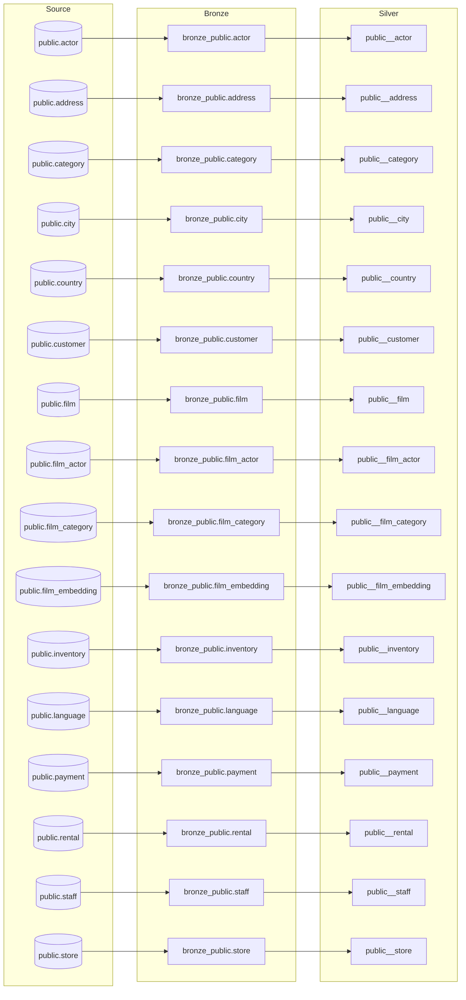

# Lineage

Table-level lineage from the source through bronze and silver to gold. Column-level lineage is on [Column lineage (source-to-target mapping)](../lineage/column-lineage.md) and on every table page.

| Source | Bronze | Silver | Read by |
|---|---|---|---|
| [public.actor](../source/tables/public.actor.md) | `bronze_public.actor` | [public__actor](../target/silver/tables/public__actor.md) |  |
| [public.address](../source/tables/public.address.md) | `bronze_public.address` | [public__address](../target/silver/tables/public__address.md) |  |
| [public.category](../source/tables/public.category.md) | `bronze_public.category` | [public__category](../target/silver/tables/public__category.md) |  |
| [public.city](../source/tables/public.city.md) | `bronze_public.city` | [public__city](../target/silver/tables/public__city.md) |  |
| [public.country](../source/tables/public.country.md) | `bronze_public.country` | [public__country](../target/silver/tables/public__country.md) |  |
| [public.customer](../source/tables/public.customer.md) | `bronze_public.customer` | [public__customer](../target/silver/tables/public__customer.md) |  |
| [public.film](../source/tables/public.film.md) | `bronze_public.film` | [public__film](../target/silver/tables/public__film.md) |  |
| [public.film_actor](../source/tables/public.film_actor.md) | `bronze_public.film_actor` | [public__film_actor](../target/silver/tables/public__film_actor.md) |  |
| [public.film_category](../source/tables/public.film_category.md) | `bronze_public.film_category` | [public__film_category](../target/silver/tables/public__film_category.md) |  |
| [public.film_embedding](../source/tables/public.film_embedding.md) | `bronze_public.film_embedding` | [public__film_embedding](../target/silver/tables/public__film_embedding.md) |  |
| [public.inventory](../source/tables/public.inventory.md) | `bronze_public.inventory` | [public__inventory](../target/silver/tables/public__inventory.md) |  |
| [public.language](../source/tables/public.language.md) | `bronze_public.language` | [public__language](../target/silver/tables/public__language.md) |  |
| [public.payment](../source/tables/public.payment.md) | `bronze_public.payment` | [public__payment](../target/silver/tables/public__payment.md) |  |
| [public.rental](../source/tables/public.rental.md) | `bronze_public.rental` | [public__rental](../target/silver/tables/public__rental.md) |  |
| [public.staff](../source/tables/public.staff.md) | `bronze_public.staff` | [public__staff](../target/silver/tables/public__staff.md) |  |
| [public.store](../source/tables/public.store.md) | `bronze_public.store` | [public__store](../target/silver/tables/public__store.md) |  |

## How lineage is derived

- **source → bronze:** the deployed plan's column mapping (`expr`, lossiness).
- **bronze → silver → gold:** the dbt SQL parsed in Trino's dialect (sqlglot), `select *` expanded with upstream columns.
- Edges marked _by name_ were matched on column names because the SQL did not parse.
