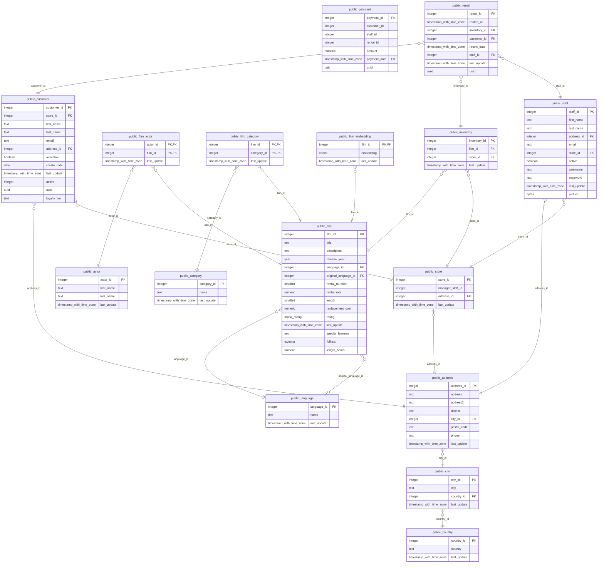

# Source ER diagram

Entities are source tables; relationships are declared foreign keys (child `}o--||` parent; `o|` when the FK column is nullable). Each table page shows its neighbourhood with every column.

## Schema `public`

