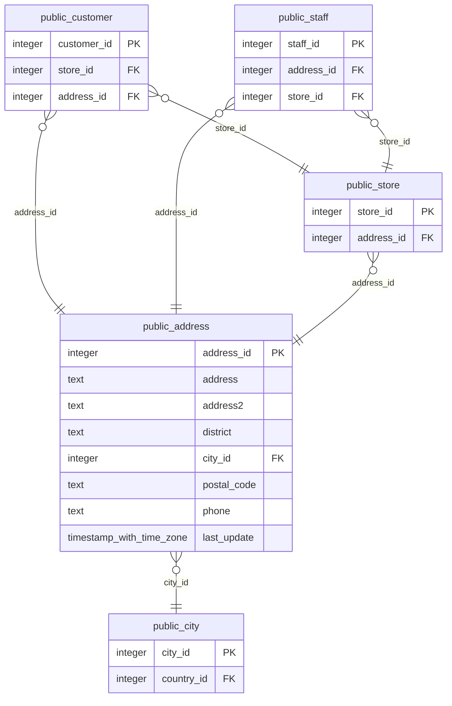

# public.address

<!-- ekos:manual id="source-public.address" -->
_Business meaning of this table, known quirks, data owner._
<!-- /ekos:manual -->

## Columns

| # | Column | Type | Null | Default | Key | References | Allowed values | PII candidate | Comment |
|---|---|---|---|---|---|---|---|---|---|
| 1 | `address_id` | `integer` | NOT NULL | yes | PK |  |  | postaladdress |  |
| 2 | `address` | `text` | NOT NULL |  |  |  |  | postaladdress |  |
| 3 | `address2` | `text` | null |  |  |  |  | postaladdress |  |
| 4 | `district` | `text` | NOT NULL |  |  |  |  |  |  |
| 5 | `city_id` | `integer` | NOT NULL |  |  | [public.city.city_id](../../source/tables/public.city.md) |  |  |  |
| 6 | `postal_code` | `text` | null |  |  |  |  | postaladdress |  |
| 7 | `phone` | `text` | NOT NULL |  |  |  |  | phone |  |
| 8 | `last_update` | `timestamp with time zone` | NOT NULL | yes |  |  |  |  |  |

## Relations

| Direction | Table | Columns | Constraint |
|---|---|---|---|
| → references | [public.city](../../source/tables/public.city.md) | city_id → city_id | address_city_id_fkey |
| ← referenced by | [public.customer](../../source/tables/public.customer.md) | address_id → address_id | customer_address_id_fkey |
| ← referenced by | [public.staff](../../source/tables/public.staff.md) | address_id → address_id | staff_address_id_fkey |
| ← referenced by | [public.store](../../source/tables/public.store.md) | address_id → address_id | store_address_id_fkey |

## Load into bronze

|  |  |
|---|---|
| Bronze table | `bronze_public.address` |
| Mode | full |
| Hard deletes | replaced with the table |
| Evidence | about 1003 rows |
| Notes |  |

Last reconciliation: **✅ green** — control fired. [Details](../../quality/reconciliation.md)

## Downstream

Silver model: [public__address](../../target/silver/tables/public__address.md)

| Column | Silver | Gold | Other models |
|---|---|---|---|
| `address_id` | `public__address.address_id` |  |  |
| `address` | `public__address.address` |  |  |
| `address2` | `public__address.address2` |  |  |
| `district` | `public__address.district` |  |  |
| `city_id` | `public__address.city_id` |  |  |
| `postal_code` | `public__address.postal_code` |  |  |
| `phone` | `public__address.phone` |  |  |
| `last_update` | `public__address.last_update` |  |  |
