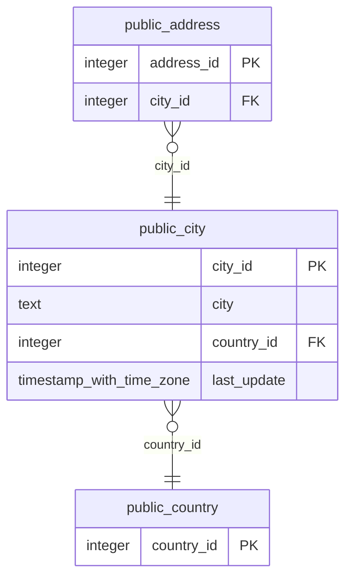

# public.city

<!-- ekos:manual id="source-public.city" -->
_Business meaning of this table, known quirks, data owner._
<!-- /ekos:manual -->

## Columns

| # | Column | Type | Null | Default | Key | References | Allowed values | PII candidate | Comment |
|---|---|---|---|---|---|---|---|---|---|
| 1 | `city_id` | `integer` | NOT NULL | yes | PK |  |  |  |  |
| 2 | `city` | `text` | NOT NULL |  |  |  |  |  |  |
| 3 | `country_id` | `integer` | NOT NULL |  |  | [public.country.country_id](../../source/tables/public.country.md) |  |  |  |
| 4 | `last_update` | `timestamp with time zone` | NOT NULL | yes |  |  |  |  |  |

## Relations

| Direction | Table | Columns | Constraint |
|---|---|---|---|
| → references | [public.country](../../source/tables/public.country.md) | country_id → country_id | city_country_id_fkey |
| ← referenced by | [public.address](../../source/tables/public.address.md) | city_id → city_id | address_city_id_fkey |

## Load into bronze

|  |  |
|---|---|
| Bronze table | `bronze_public.city` |
| Mode | full |
| Hard deletes | replaced with the table |
| Evidence | about 600 rows |
| Notes |  |

Last reconciliation: **✅ green** — control fired. [Details](../../quality/reconciliation.md)

## Downstream

Silver model: [public__city](../../target/silver/tables/public__city.md)

| Column | Silver | Gold | Other models |
|---|---|---|---|
| `city_id` | `public__city.city_id` |  |  |
| `city` | `public__city.city` |  |  |
| `country_id` | `public__city.country_id` |  |  |
| `last_update` | `public__city.last_update` |  |  |
