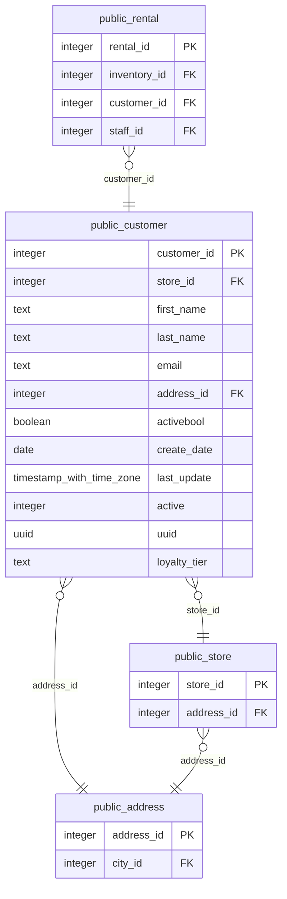

# public.customer

<!-- ekos:manual id="source-public.customer" -->
_Business meaning of this table, known quirks, data owner._
<!-- /ekos:manual -->

## Columns

| # | Column | Type | Null | Default | Key | References | Allowed values | PII candidate | Comment |
|---|---|---|---|---|---|---|---|---|---|
| 1 | `customer_id` | `integer` | NOT NULL | yes | PK |  |  |  |  |
| 2 | `store_id` | `integer` | NOT NULL |  |  | [public.store.store_id](../../source/tables/public.store.md) |  |  |  |
| 3 | `first_name` | `text` | NOT NULL |  |  |  |  | personname |  |
| 4 | `last_name` | `text` | NOT NULL |  |  |  |  | personname |  |
| 5 | `email` | `text` | null |  |  |  |  | email |  |
| 6 | `address_id` | `integer` | NOT NULL |  |  | [public.address.address_id](../../source/tables/public.address.md) |  | postaladdress |  |
| 7 | `activebool` | `boolean` | NOT NULL | yes |  |  |  |  |  |
| 8 | `create_date` | `date` | NOT NULL | yes |  |  |  |  |  |
| 9 | `last_update` | `timestamp with time zone` | null | yes |  |  |  |  |  |
| 10 | `active` | `integer` | null |  |  |  |  |  |  |
| 11 | `uuid` | `uuid` | NOT NULL | yes |  |  |  |  |  |
| 13 | `loyalty_tier` | `text` | null |  |  |  |  |  |  |

## Relations

| Direction | Table | Columns | Constraint |
|---|---|---|---|
| → references | [public.address](../../source/tables/public.address.md) | address_id → address_id | customer_address_id_fkey |
| → references | [public.store](../../source/tables/public.store.md) | store_id → store_id | customer_store_id_fkey |
| ← referenced by | [public.rental](../../source/tables/public.rental.md) | customer_id → customer_id | rental_customer_id_fkey |

## Load into bronze

|  |  |
|---|---|
| Bronze table | `bronze_public.customer` |
| Mode | incremental on watermark `last_update` |
| Hard deletes | key-set diff (tombstones) |
| Evidence | last_update declared as the watermark in settings trigger last_updated runs last_updated() before every update and assigns NEW.last_update last_updated() body sha256 df2a5d93f0f45c50 primary key (customer_id) allows a key-set diff for deletes |
| Notes |  |

Last reconciliation: **✅ green** — control fired. [Details](../../quality/reconciliation.md)

## Downstream

Silver model: [public__customer](../../target/silver/tables/public__customer.md)

| Column | Silver | Gold | Other models |
|---|---|---|---|
| `customer_id` | `public__customer.customer_id` |  |  |
| `store_id` | `public__customer.store_id` |  |  |
| `first_name` | `public__customer.first_name` |  |  |
| `last_name` | `public__customer.last_name` |  |  |
| `email` | `public__customer.email` |  |  |
| `address_id` | `public__customer.address_id` |  |  |
| `activebool` | `public__customer.activebool` |  |  |
| `create_date` | `public__customer.create_date` |  |  |
| `last_update` | `public__customer.last_update` |  |  |
| `active` | `public__customer.active` |  |  |
| `uuid` | `public__customer.uuid` |  |  |
| `loyalty_tier` | `public__customer.loyalty_tier` |  |  |
