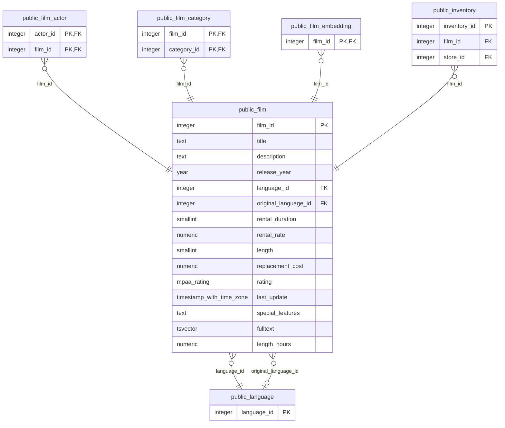

# public.film

<!-- ekos:manual id="source-public.film" -->
_Business meaning of this table, known quirks, data owner._
<!-- /ekos:manual -->

## Columns

| # | Column | Type | Null | Default | Key | References | Allowed values | PII candidate | Comment |
|---|---|---|---|---|---|---|---|---|---|
| 1 | `film_id` | `integer` | NOT NULL | yes | PK |  |  |  |  |
| 2 | `title` | `text` | NOT NULL |  |  |  |  |  |  |
| 3 | `description` | `text` | null |  |  |  |  |  |  |
| 4 | `release_year` | `year` | null |  |  |  |  |  |  |
| 5 | `language_id` | `integer` | NOT NULL |  |  | [public.language.language_id](../../source/tables/public.language.md) |  |  |  |
| 6 | `original_language_id` | `integer` | null |  |  | [public.language.language_id](../../source/tables/public.language.md) |  |  |  |
| 7 | `rental_duration` | `smallint` | NOT NULL | yes |  |  |  |  |  |
| 8 | `rental_rate` | `numeric(4,2)` | NOT NULL | yes |  |  |  |  |  |
| 9 | `length` | `smallint` | null |  |  |  |  |  |  |
| 10 | `replacement_cost` | `numeric(5,2)` | NOT NULL | yes |  |  |  |  |  |
| 11 | `rating` | `mpaa_rating` | null | yes |  |  | G, PG, PG-13, R, NC-17 |  |  |
| 12 | `last_update` | `timestamp with time zone` | NOT NULL | yes |  |  |  |  |  |
| 13 | `special_features` | `text[]` | null |  |  |  |  |  |  |
| 14 | `fulltext` | `tsvector` | NOT NULL |  |  |  |  |  |  |
| 15 | `length_hours` | `numeric(4,2)` | null | yes |  |  |  |  |  |

## Relations

| Direction | Table | Columns | Constraint |
|---|---|---|---|
| → references | [public.language](../../source/tables/public.language.md) | language_id → language_id | film_language_id_fkey |
| → references | [public.language](../../source/tables/public.language.md) | original_language_id → language_id | film_original_language_id_fkey |
| ← referenced by | [public.film_actor](../../source/tables/public.film_actor.md) | film_id → film_id | film_actor_film_id_fkey |
| ← referenced by | [public.film_category](../../source/tables/public.film_category.md) | film_id → film_id | film_category_film_id_fkey |
| ← referenced by | [public.film_embedding](../../source/tables/public.film_embedding.md) | film_id → film_id | film_embedding_film_id_fkey |
| ← referenced by | [public.inventory](../../source/tables/public.inventory.md) | film_id → film_id | inventory_film_id_fkey |

## Load into bronze

|  |  |
|---|---|
| Bronze table | `bronze_public.film` |
| Mode | incremental on watermark `last_update` |
| Hard deletes | key-set diff (tombstones) |
| Evidence | last_update declared as the watermark in settings trigger last_updated runs last_updated() before every update and assigns NEW.last_update last_updated() body sha256 df2a5d93f0f45c50 primary key (film_id) allows a key-set diff for deletes |
| Notes |  |

Last reconciliation: **✅ green** — control fired. [Details](../../quality/reconciliation.md)

## Downstream

Silver model: [public__film](../../target/silver/tables/public__film.md)

| Column | Silver | Gold | Other models |
|---|---|---|---|
| `film_id` | `public__film.film_id` |  |  |
| `title` | `public__film.title` |  |  |
| `description` | `public__film.description` |  |  |
| `release_year` | `public__film.release_year` |  |  |
| `language_id` | `public__film.language_id` |  |  |
| `original_language_id` | `public__film.original_language_id` |  |  |
| `rental_duration` | `public__film.rental_duration` |  |  |
| `rental_rate` | `public__film.rental_rate` |  |  |
| `length` | `public__film.length` |  |  |
| `replacement_cost` | `public__film.replacement_cost` |  |  |
| `rating` | `public__film.rating` |  |  |
| `last_update` | `public__film.last_update` |  |  |
| `special_features` | `public__film.special_features` |  |  |
| `fulltext` | `public__film.fulltext` |  |  |
| `length_hours` | `public__film.length_hours` |  |  |
