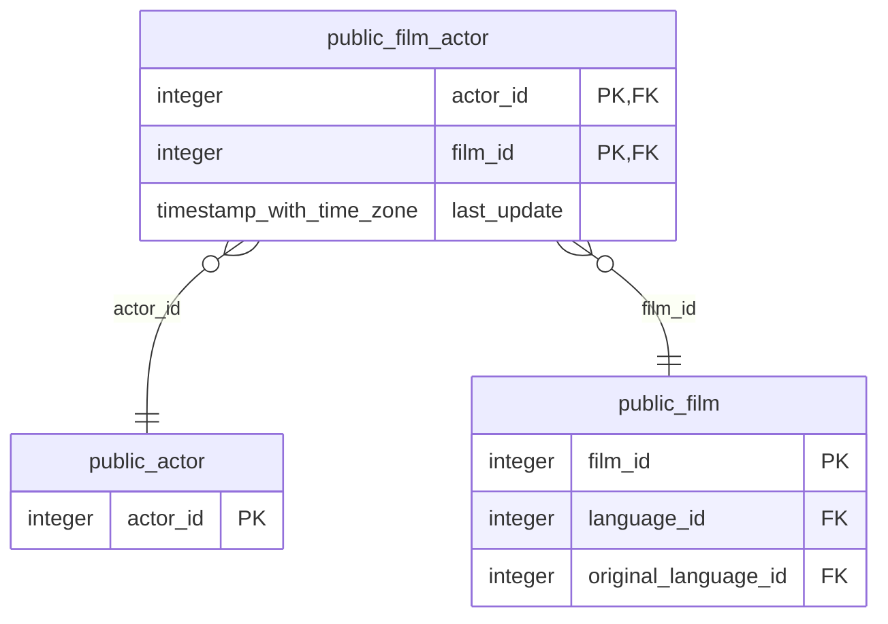

# public.film_actor

<!-- ekos:manual id="source-public.film_actor" -->
_Business meaning of this table, known quirks, data owner._
<!-- /ekos:manual -->

## Columns

| # | Column | Type | Null | Default | Key | References | Allowed values | PII candidate | Comment |
|---|---|---|---|---|---|---|---|---|---|
| 1 | `actor_id` | `integer` | NOT NULL |  | PK | [public.actor.actor_id](../../source/tables/public.actor.md) |  |  |  |
| 2 | `film_id` | `integer` | NOT NULL |  | PK | [public.film.film_id](../../source/tables/public.film.md) |  |  |  |
| 3 | `last_update` | `timestamp with time zone` | NOT NULL | yes |  |  |  |  |  |

## Relations

| Direction | Table | Columns | Constraint |
|---|---|---|---|
| → references | [public.actor](../../source/tables/public.actor.md) | actor_id → actor_id | film_actor_actor_id_fkey |
| → references | [public.film](../../source/tables/public.film.md) | film_id → film_id | film_actor_film_id_fkey |

## Load into bronze

|  |  |
|---|---|
| Bronze table | `bronze_public.film_actor` |
| Mode | full |
| Hard deletes | replaced with the table |
| Evidence | about 5462 rows |
| Notes |  |

Last reconciliation: **✅ green** — control fired. [Details](../../quality/reconciliation.md)

## Downstream

Silver model: [public__film_actor](../../target/silver/tables/public__film_actor.md)

| Column | Silver | Gold | Other models |
|---|---|---|---|
| `actor_id` | `public__film_actor.actor_id` |  |  |
| `film_id` | `public__film_actor.film_id` |  |  |
| `last_update` | `public__film_actor.last_update` |  |  |
