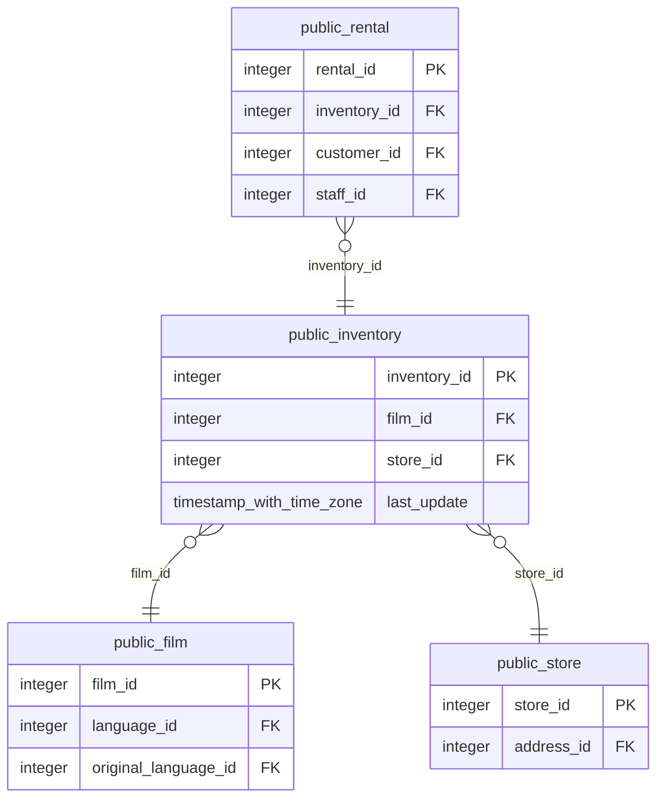

# public.inventory

<!-- ekos:manual id="source-public.inventory" -->
_Business meaning of this table, known quirks, data owner._
<!-- /ekos:manual -->

## Columns

| # | Column | Type | Null | Default | Key | References | Allowed values | PII candidate | Comment |
|---|---|---|---|---|---|---|---|---|---|
| 1 | `inventory_id` | `integer` | NOT NULL | yes | PK |  |  |  |  |
| 2 | `film_id` | `integer` | NOT NULL |  |  | [public.film.film_id](../../source/tables/public.film.md) |  |  |  |
| 3 | `store_id` | `integer` | NOT NULL |  |  | [public.store.store_id](../../source/tables/public.store.md) |  |  |  |
| 4 | `last_update` | `timestamp with time zone` | NOT NULL | yes |  |  |  |  |  |

## Relations

| Direction | Table | Columns | Constraint |
|---|---|---|---|
| → references | [public.film](../../source/tables/public.film.md) | film_id → film_id | inventory_film_id_fkey |
| → references | [public.store](../../source/tables/public.store.md) | store_id → store_id | inventory_store_id_fkey |
| ← referenced by | [public.rental](../../source/tables/public.rental.md) | inventory_id → inventory_id | rental_inventory_id_fkey |

## Load into bronze

|  |  |
|---|---|
| Bronze table | `bronze_public.inventory` |
| Mode | incremental on watermark `last_update` |
| Hard deletes | key-set diff (tombstones) |
| Evidence | last_update declared as the watermark in settings trigger last_updated runs last_updated() before every update and assigns NEW.last_update last_updated() body sha256 df2a5d93f0f45c50 primary key (inventory_id) allows a key-set diff for deletes |
| Notes |  |

Last reconciliation: **✅ green** — control fired. [Details](../../quality/reconciliation.md)

## Downstream

Silver model: [public__inventory](../../target/silver/tables/public__inventory.md)

| Column | Silver | Gold | Other models |
|---|---|---|---|
| `inventory_id` | `public__inventory.inventory_id` |  |  |
| `film_id` | `public__inventory.film_id` |  |  |
| `store_id` | `public__inventory.store_id` |  |  |
| `last_update` | `public__inventory.last_update` |  |  |
