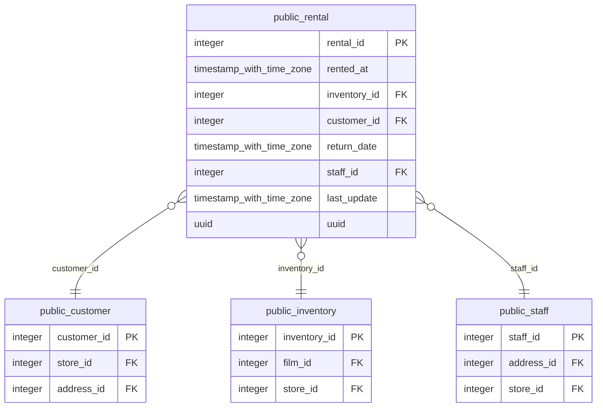

# public.rental

<!-- ekos:manual id="source-public.rental" -->
_Business meaning of this table, known quirks, data owner._
<!-- /ekos:manual -->

## Columns

| # | Column | Type | Null | Default | Key | References | Allowed values | PII candidate | Comment |
|---|---|---|---|---|---|---|---|---|---|
| 1 | `rental_id` | `integer` | NOT NULL | yes | PK |  |  |  |  |
| 2 | `rented_at` | `timestamp with time zone` | NOT NULL |  |  |  |  |  |  |
| 3 | `inventory_id` | `integer` | NOT NULL |  |  | [public.inventory.inventory_id](../../source/tables/public.inventory.md) |  |  |  |
| 4 | `customer_id` | `integer` | NOT NULL |  |  | [public.customer.customer_id](../../source/tables/public.customer.md) |  |  |  |
| 5 | `return_date` | `timestamp with time zone` | null |  |  |  |  |  |  |
| 6 | `staff_id` | `integer` | NOT NULL |  |  | [public.staff.staff_id](../../source/tables/public.staff.md) |  |  |  |
| 7 | `last_update` | `timestamp with time zone` | NOT NULL | yes |  |  |  |  |  |
| 8 | `uuid` | `uuid` | NOT NULL | yes |  |  |  |  |  |

## Relations

| Direction | Table | Columns | Constraint |
|---|---|---|---|
| → references | [public.customer](../../source/tables/public.customer.md) | customer_id → customer_id | rental_customer_id_fkey |
| → references | [public.inventory](../../source/tables/public.inventory.md) | inventory_id → inventory_id | rental_inventory_id_fkey |
| → references | [public.staff](../../source/tables/public.staff.md) | staff_id → staff_id | rental_staff_id_fkey |

## Load into bronze

|  |  |
|---|---|
| Bronze table | `bronze_public.rental` |
| Mode | incremental on watermark `last_update` |
| Hard deletes | key-set diff (tombstones) |
| Evidence | last_update declared as the watermark in settings trigger last_updated runs last_updated() before every update and assigns NEW.last_update last_updated() body sha256 df2a5d93f0f45c50 primary key (rental_id) allows a key-set diff for deletes |
| Notes |  |

Approved renames (applied in place): `rental_date` → `rented_at`

Last reconciliation: **✅ green** — control fired. [Details](../../quality/reconciliation.md)

## Downstream

Silver model: [public__rental](../../target/silver/tables/public__rental.md)

| Column | Silver | Gold | Other models |
|---|---|---|---|
| `rental_id` | `public__rental.rental_id` |  |  |
| `rented_at` | `public__rental.rented_at` |  |  |
| `inventory_id` | `public__rental.inventory_id` |  |  |
| `customer_id` | `public__rental.customer_id` |  |  |
| `return_date` | `public__rental.return_date` |  |  |
| `staff_id` | `public__rental.staff_id` |  |  |
| `last_update` | `public__rental.last_update` |  |  |
| `uuid` | `public__rental.uuid` |  |  |
