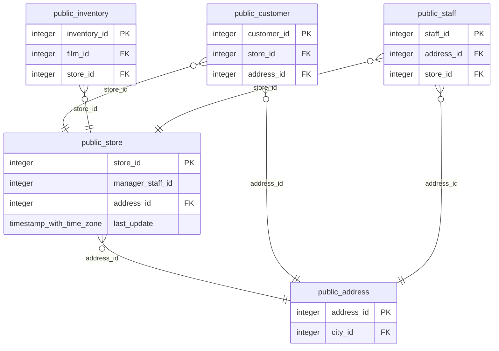

# public.store

<!-- ekos:manual id="source-public.store" -->
_Business meaning of this table, known quirks, data owner._
<!-- /ekos:manual -->

## Columns

| # | Column | Type | Null | Default | Key | References | Allowed values | PII candidate | Comment |
|---|---|---|---|---|---|---|---|---|---|
| 1 | `store_id` | `integer` | NOT NULL | yes | PK |  |  |  |  |
| 2 | `manager_staff_id` | `integer` | NOT NULL |  |  |  |  |  |  |
| 3 | `address_id` | `integer` | NOT NULL |  |  | [public.address.address_id](../../source/tables/public.address.md) |  | postaladdress |  |
| 4 | `last_update` | `timestamp with time zone` | NOT NULL | yes |  |  |  |  |  |

## Relations

| Direction | Table | Columns | Constraint |
|---|---|---|---|
| → references | [public.address](../../source/tables/public.address.md) | address_id → address_id | store_address_id_fkey |
| ← referenced by | [public.customer](../../source/tables/public.customer.md) | store_id → store_id | customer_store_id_fkey |
| ← referenced by | [public.inventory](../../source/tables/public.inventory.md) | store_id → store_id | inventory_store_id_fkey |
| ← referenced by | [public.staff](../../source/tables/public.staff.md) | store_id → store_id | staff_store_id_fkey |

## Load into bronze

|  |  |
|---|---|
| Bronze table | `bronze_public.store` |
| Mode | full |
| Hard deletes | replaced with the table |
| Evidence | about 500 rows |
| Notes |  |

Last reconciliation: **✅ green** — control fired. [Details](../../quality/reconciliation.md)

## Downstream

Silver model: [public__store](../../target/silver/tables/public__store.md)

| Column | Silver | Gold | Other models |
|---|---|---|---|
| `store_id` | `public__store.store_id` |  |  |
| `manager_staff_id` | `public__store.manager_staff_id` |  |  |
| `address_id` | `public__store.address_id` |  |  |
| `last_update` | `public__store.last_update` |  |  |
