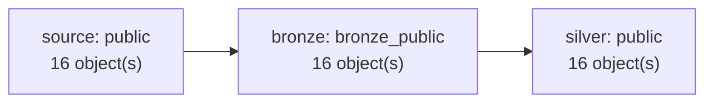

# Target

The target is a medallion lakehouse of Apache Iceberg tables.

| Layer | Objects | Page |
|---|---|---|
| Bronze | 16 tables | [Bronze](../target/bronze.md) |
| Silver | 16 models, 0 snapshots | [Silver](../target/silver/index.md) |
| Gold | 0 marts | [Gold](../target/gold/index.md) |

